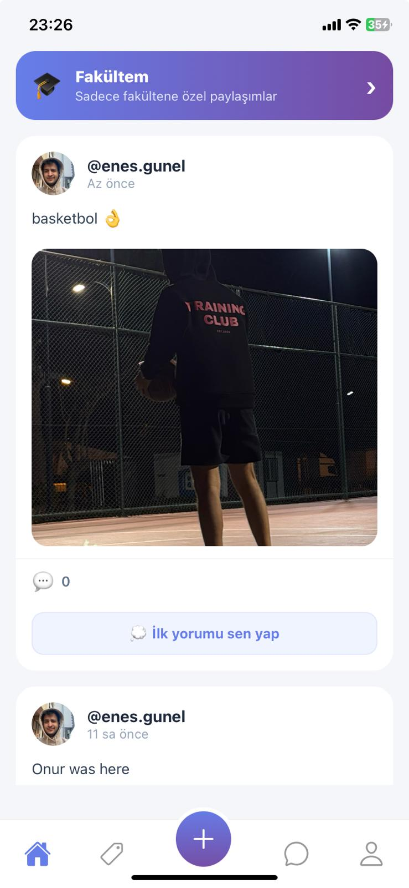
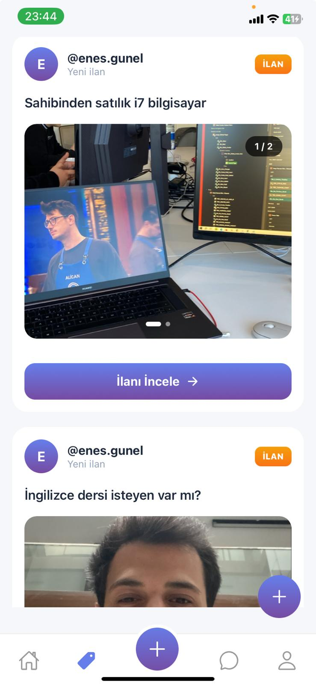
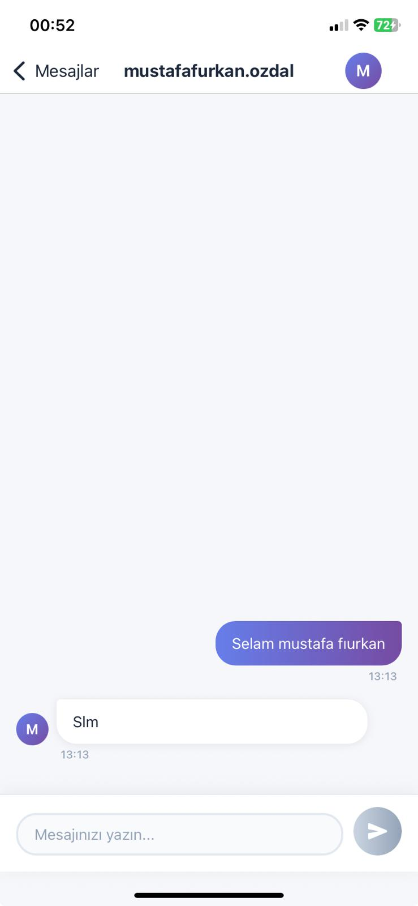

<div align="center">


# Hops

**The verified social network for university campuses.**

*Kampüsün Akışı — Every campus, its own feed.*

[](https://reactnative.dev/)
[](https://expo.dev/)
[](https://www.typescriptlang.org/)
[](https://firebase.google.com/)

[Türkçe README](./README.tr.md)

</div>

---

## About the Project

**Hops** is a mobile social platform built exclusively for university students, where every account is verified through an official `.edu` (student) email address. Unlike general-purpose social networks, Hops isolates each faculty into its own feed, giving students a trusted space to share, ask, sell, and connect with peers who are actually in their classes.

The product was validated through a **100-user closed beta** at Dokuz Eylül University and is currently supported by DEÜ Teknopark's **BAMBU Step Up** and **BİGG** entrepreneurship programs.

### Why Hops?

- **Structural moat**: `.edu` verification is a barrier Instagram, X, and WhatsApp cannot replicate — universities issue the credentials.
- **Signal over noise**: A faculty-scoped feed reaches the people who share your building, your professors, your exam dates.
- **Verified polls, verified marketplace**: Every vote and every listing comes from a real, single-account student.

---

## Screenshots

| Login | Faculty Feed | Marketplace | Real-time Chat | Profile |
|:---:|:---:|:---:|:---:|:---:|
|  |  |  |  |  |

---

## Core Features

| # | Feature | What it does |
|---|---------|--------------|
| 1 | **.edu Verification** | Registration is gated by a valid student email — the anchor of the entire product. |
| 2 | **Faculty Feed** | Posts are scoped to the poster's faculty, creating a signal-rich, low-noise timeline. |
| 3 | **Trusted Polls** | One student, one vote — verified identity eliminates bot and duplicate voting. |
| 4 | **Campus Marketplace** | Second-hand listings (books, electronics, dorm goods) between verified students. |
| 5 | **Real-time DM** | 1-to-1 messaging backed by Firestore's realtime listeners. |

Navigation is a five-tab bar: **Feed / Listings / [+Post] / Messages / Profile**.

---

## Tech Stack

**Frontend**
- React Native `0.76` (New Architecture enabled)
- Expo SDK `53` — managed workflow, EAS Build
- TypeScript `5.9`
- React Navigation `7` (Native Stack + Bottom Tabs)
- `expo-linear-gradient`, `expo-image-picker`, `expo-document-picker`, `expo-sharing`

**Backend (Serverless)**
- **Firebase Authentication** — email/password with `.edu` domain enforcement
- **Cloud Firestore** — posts, faculty posts, comments, chats, listings, user profiles
- **Firebase Storage** — profile photos, post media, listing images
- Realtime listeners power the DM inbox and live feed updates

**Tooling**
- EAS Build for Android release artifacts (`com.gunelenes.social_app_v3`)
- AsyncStorage for auth persistence
- Safe Area Context + React Native Screens for native-feeling navigation

---

## Architecture

```
src/
├── firebase/          # Auth, Firestore & Storage abstractions
│   ├── auth.ts            # .edu email verification, session persistence
│   ├── posts.ts           # Global feed CRUD
│   ├── facultyPosts.ts    # Faculty-scoped feed CRUD
│   ├── comments.ts        # Threaded comments
│   ├── getPosts.ts        # Query composition & pagination
│   ├── user.ts            # Profile documents
│   ├── storage.ts         # Media upload pipeline
│   └── firebaseConfig.ts  # SDK initialization
├── services/          # Higher-level domain services
│   ├── chat.ts            # 1-to-1 chat orchestration
│   └── messages.ts        # Realtime message streams
├── screens/           # 16 screens covering the full product surface
│   ├── LoginScreen.tsx / RegisterScreen.tsx
│   ├── FeedScreen.tsx / FacultyFeedScreen.tsx / FacultyCreatePostScreen.tsx
│   ├── ListingsFeedScreen.tsx / CreateListingScreen.tsx / EditListingScreen.tsx / ListingDetailScreen.tsx
│   ├── MessagesScreen.tsx / ChatScreen.tsx
│   ├── ProfileScreen.tsx / UserDetailScreen.tsx / UserSearchScreen.tsx
│   ├── CommentsScreen.tsx / PostModalScreen.tsx
├── navigation/        # RootNavigator (auth gate) + TabNavigator
├── components/        # Shared UI primitives
├── constants/         # Faculty list, brand tokens
├── types/             # Domain models (Post, etc.)
└── utils/             # File download helpers, misc
```

Auth state gates navigation at the root: unauthenticated users see Login/Register; authenticated users get the tab shell.

---

## Getting Started

### Prerequisites
- Node.js `>= 18`
- Expo CLI (`npm install -g expo`)
- A Firebase project with Firestore, Storage, and Email/Password Auth enabled
- Android Studio / Xcode for native builds (optional — Expo Go works for development)

### Setup

```bash
# 1. Clone
git clone https://github.com/<your-username>/hops.git
cd hops

# 2. Install dependencies
npm install

# 3. Configure Firebase
# Add your Firebase config to src/firebase/firebaseConfig.ts
# (apiKey, authDomain, projectId, storageBucket, ...)

# 4. Run
npm start           # Expo dev server
npm run android     # Android build
npm run ios         # iOS build
npm run web         # Web preview
```

### Building for Release

```bash
# Android AAB via EAS
eas build --platform android --profile production
```

---

## Roadmap

- [x] `.edu` verified registration
- [x] Faculty-scoped feed with posts, likes, comments
- [x] Marketplace with photo listings and detail view
- [x] Realtime 1-to-1 messaging
- [x] Profile with post + listing history
- [x] 100-user closed beta at DEÜ
- [ ] Trusted polls (design ready, implementation in progress)
- [ ] Push notifications (Expo Notifications)
- [ ] Multi-university rollout (İzmir 5: DEÜ, EÜ, İYTE, Yaşar, İzmir Ekonomi)
- [ ] iOS TestFlight release
- [ ] Public launch — Q4 2026

---

## Brand Identity

- **Primary gradient**: Indigo `#667eea` → Purple `#764ba2` (135°)
- **Accent gradient**: Amber `#fde047` → `#f59e0b`
- **Dark surfaces**: `#1f1b4b`, `#14112E`
- **Muted text**: `#a9a7c6`

---

## About the Developer

**Enes Günel** — Founder & Solo Developer
Faculty of Engineering, Dokuz Eylül University

Hops is designed, built, shipped, and pitched end-to-end by a single developer. From `.edu` verification logic to Firestore data modeling, from the pitch deck to the print poster, every artifact in this repository was authored to demonstrate ownership of the full product lifecycle.

- Email: `eenesgunell@gmail.com`
- Student email: `2019510105@ogr.deu.edu.tr`
- Location: İzmir, Turkey

---

## License

This repository is shared for portfolio and evaluation purposes. Contact the author before reusing any code or brand asset.
