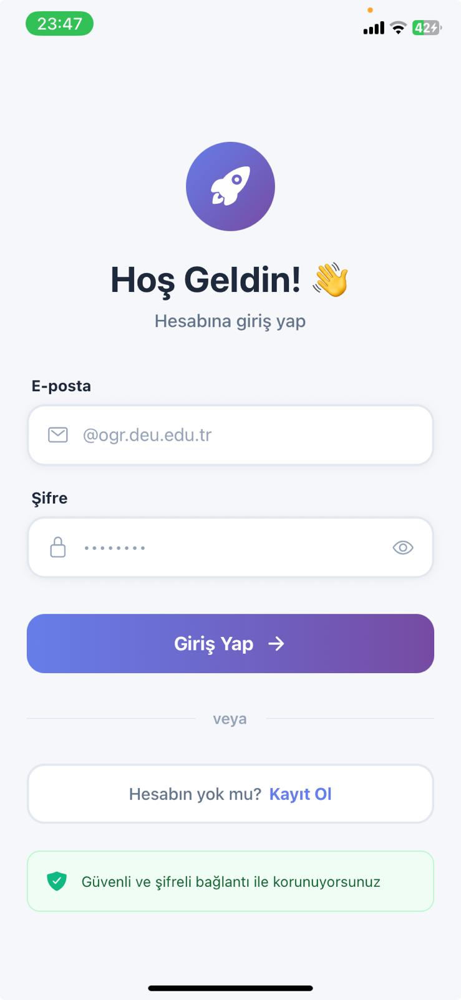
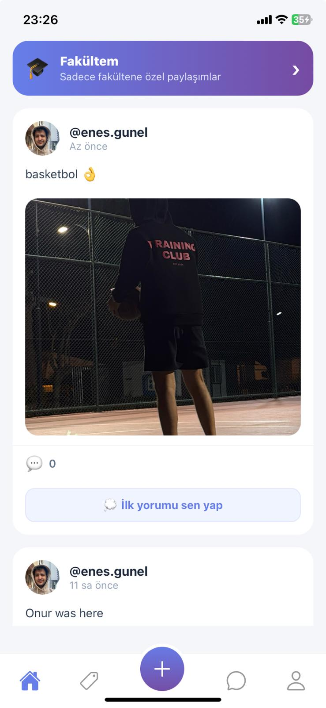
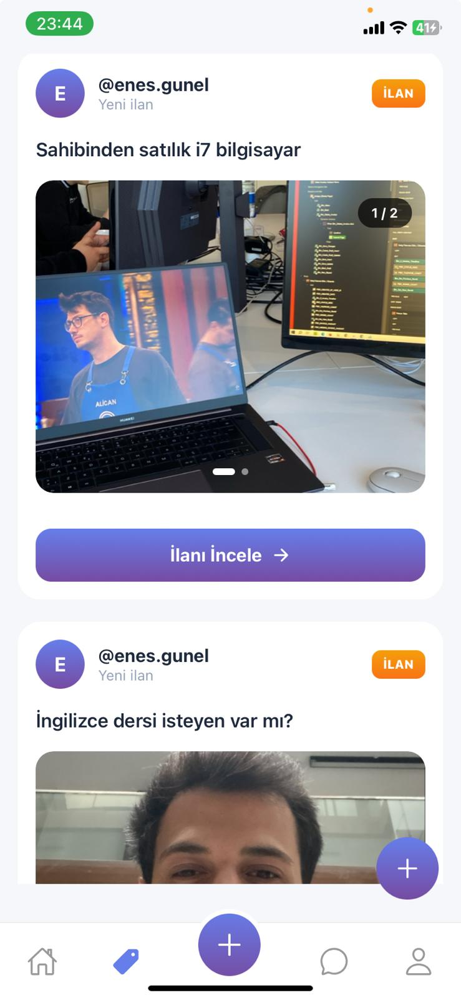
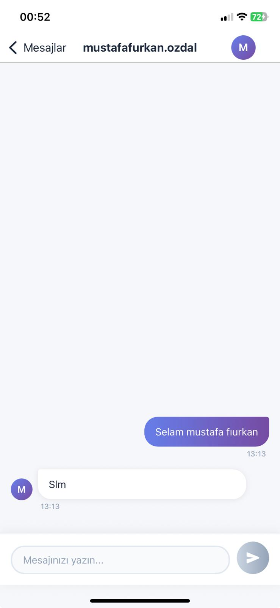
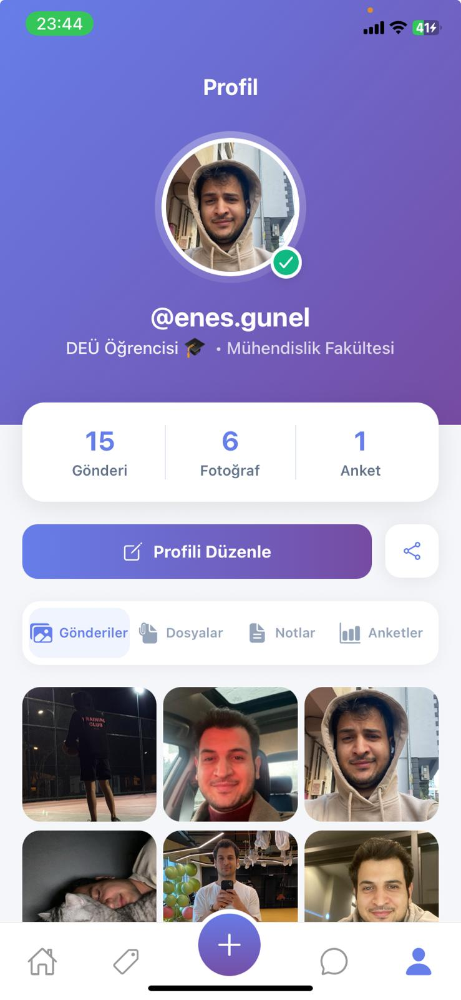

<div align="center">


# Hops

**Üniversite kampüsleri için doğrulanmış sosyal ağ.**

*Kampüsün Akışı — Her kampüs için, kendi akışı.*

[](https://reactnative.dev/)
[](https://expo.dev/)
[](https://www.typescriptlang.org/)
[](https://firebase.google.com/)

[English README](./README.md)

</div>

---

## Proje Hakkında

**Hops**, yalnızca üniversite öğrencilerine yönelik, her hesabın resmî `.edu` (öğrenci) e-posta adresiyle doğrulandığı bir mobil sosyal platformdur. Genel amaçlı sosyal ağların aksine Hops, her fakülteyi kendi akışına izole ederek öğrencilere aynı sınıfta okudukları kişilerle paylaşım yapabilecekleri, soru sorabilecekleri, alışveriş yapabilecekleri ve iletişim kurabilecekleri güvenilir bir alan sunar.

Ürün, Dokuz Eylül Üniversitesi'nde **100 kişilik kapalı beta** ile doğrulanmış olup şu anda DEÜ Teknopark'ın **BAMBU Step Up** ve **BİGG** girişimcilik programları tarafından desteklenmektedir.

### Neden Hops?

- **Yapısal hendek**: `.edu` doğrulaması Instagram, X ve WhatsApp'ın kopyalayamayacağı bir bariyerdir — kimlik bilgilerini üniversiteler verir.
- **Gürültü yerine sinyal**: Fakülte odaklı akış, aynı binada, aynı hocalarla, aynı sınav takvimiyle çalışan kişilere ulaşır.
- **Doğrulanmış anket, doğrulanmış pazar**: Her oy ve her ilan gerçek ve tekil bir öğrenciden gelir.

---

## Ekran Görüntüleri

| Giriş | Fakülte Akışı | Pazar Yeri | Anlık Sohbet | Profil |
|:---:|:---:|:---:|:---:|:---:|
|  |  |  |  |  |

---

## Temel Özellikler

| # | Özellik | Ne yapar? |
|---|---------|-----------|
| 1 | **.edu Doğrulama** | Kayıt, geçerli bir öğrenci e-postası şartına bağlıdır — ürünün ana ekseni. |
| 2 | **Fakülte Akışı** | Gönderiler, paylaşanın fakültesiyle sınırlıdır; sinyal yüksek, gürültü düşük bir zaman tüneli oluşturur. |
| 3 | **Güvenilir Anket** | Bir öğrenci, bir oy — doğrulanmış kimlik bot ve tekrar oy sorununu ortadan kaldırır. |
| 4 | **Kampüs Pazarı** | Doğrulanmış öğrenciler arasında ikinci el ilanlar (kitap, elektronik, ev eşyası). |
| 5 | **Anlık DM** | Firestore'un gerçek zamanlı dinleyicileriyle çalışan 1-1 mesajlaşma. |

Navigasyon beş sekmelidir: **Akış / İlanlar / [+Gönderi] / Mesajlar / Profil**.

---

## Teknoloji Stack'i

**Ön Uç**
- React Native `0.76` (New Architecture aktif)
- Expo SDK `53` — managed workflow, EAS Build
- TypeScript `5.9`
- React Navigation `7` (Native Stack + Bottom Tabs)
- `expo-linear-gradient`, `expo-image-picker`, `expo-document-picker`, `expo-sharing`

**Arka Uç (Sunucusuz)**
- **Firebase Authentication** — `.edu` alan adı doğrulamalı e-posta/şifre girişi
- **Cloud Firestore** — gönderiler, fakülte gönderileri, yorumlar, sohbetler, ilanlar, kullanıcı profilleri
- **Firebase Storage** — profil fotoğrafları, gönderi görselleri, ilan medyası
- Gerçek zamanlı dinleyiciler DM ve akış güncellemelerini besler

**Araçlar**
- Android sürüm çıktıları için EAS Build (`com.gunelenes.social_app_v3`)
- Oturum kalıcılığı için AsyncStorage
- Safe Area Context + React Native Screens ile native hissi veren navigasyon

---

## Mimari

```
src/
├── firebase/          # Auth, Firestore ve Storage soyutlamaları
│   ├── auth.ts            # .edu e-posta doğrulama, oturum kalıcılığı
│   ├── posts.ts           # Genel akış CRUD
│   ├── facultyPosts.ts    # Fakülte odaklı akış CRUD
│   ├── comments.ts        # Yorum dizisi
│   ├── getPosts.ts        # Sorgu kompozisyonu & sayfalama
│   ├── user.ts            # Profil belgeleri
│   ├── storage.ts         # Medya yükleme hattı
│   └── firebaseConfig.ts  # SDK başlatma
├── services/          # Alan seviyesi servisler
│   ├── chat.ts            # 1-1 sohbet orkestrasyonu
│   └── messages.ts        # Gerçek zamanlı mesaj akışları
├── screens/           # Ürünün tüm yüzeyini kapsayan 16 ekran
│   ├── LoginScreen.tsx / RegisterScreen.tsx
│   ├── FeedScreen.tsx / FacultyFeedScreen.tsx / FacultyCreatePostScreen.tsx
│   ├── ListingsFeedScreen.tsx / CreateListingScreen.tsx / EditListingScreen.tsx / ListingDetailScreen.tsx
│   ├── MessagesScreen.tsx / ChatScreen.tsx
│   ├── ProfileScreen.tsx / UserDetailScreen.tsx / UserSearchScreen.tsx
│   ├── CommentsScreen.tsx / PostModalScreen.tsx
├── navigation/        # RootNavigator (kimlik kapısı) + TabNavigator
├── components/        # Paylaşılan UI birimleri
├── constants/         # Fakülte listesi, marka tokenları
├── types/             # Alan modelleri (Post, vb.)
└── utils/             # Dosya indirme yardımcıları
```

Kimlik durumu navigasyonu kökten kontrol eder: giriş yapmamış kullanıcılar Login/Register görür, giriş yapmış olanlar sekmeli kabuğa alınır.

---

## Başlangıç

### Gereksinimler
- Node.js `>= 18`
- Expo CLI (`npm install -g expo`)
- Firestore, Storage ve E-posta/Şifre Auth'un aktif olduğu bir Firebase projesi
- Native build için Android Studio / Xcode (opsiyonel — geliştirme için Expo Go yeterli)

### Kurulum

```bash
# 1. Klonla
git clone https://github.com/<kullanici-adiniz>/hops.git
cd hops

# 2. Bağımlılıkları kur
npm install

# 3. Firebase'i yapılandır
# Firebase konfigürasyonunuzu src/firebase/firebaseConfig.ts dosyasına ekleyin
# (apiKey, authDomain, projectId, storageBucket, ...)

# 4. Çalıştır
npm start           # Expo geliştirme sunucusu
npm run android     # Android build
npm run ios         # iOS build
npm run web         # Web önizleme
```

### Sürüm Build'i

```bash
# EAS üzerinden Android AAB
eas build --platform android --profile production
```

---

## Yol Haritası

- [x] `.edu` doğrulamalı kayıt
- [x] Gönderi, beğeni ve yorumlu fakülte akışı
- [x] Fotoğraflı ilan ve detay ekranıyla pazar yeri
- [x] Gerçek zamanlı 1-1 mesajlaşma
- [x] Gönderi ve ilan geçmişli profil
- [x] DEÜ'de 100 kişilik kapalı beta
- [ ] Güvenilir anket (tasarım hazır, geliştirme devam ediyor)
- [ ] Push bildirimleri (Expo Notifications)
- [ ] Çoklu üniversite açılımı (İzmir 5: DEÜ, EÜ, İYTE, Yaşar, İzmir Ekonomi)
- [ ] iOS TestFlight sürümü
- [ ] Genel lansman — 2026 Q4

---

## Marka Kimliği

- **Ana degrade**: Indigo `#667eea` → Purple `#764ba2` (135°)
- **Aksan degrade**: Amber `#fde047` → `#f59e0b`
- **Koyu yüzeyler**: `#1f1b4b`, `#14112E`
- **Kısık metin**: `#a9a7c6`

---

## Geliştirici Hakkında

**Enes Günel** — Kurucu & Solo Geliştirici
Dokuz Eylül Üniversitesi, Mühendislik Fakültesi

Hops'un tasarımı, geliştirilmesi, yayına alınması ve yatırımcı sunumu tek bir geliştirici tarafından uçtan uca üstlenilmiştir. `.edu` doğrulama mantığından Firestore veri modellemesine, pitch deck'ten baskı posterine kadar bu depodaki her artefakt, tam ürün yaşam döngüsünün sahiplenildiğini göstermek üzere üretilmiştir.

- E-posta: `eenesgunell@gmail.com`
- Öğrenci e-postası: `2019510105@ogr.deu.edu.tr`
- Konum: İzmir, Türkiye

---

## Lisans

Bu depo portfolyo ve değerlendirme amacıyla paylaşılmıştır. Herhangi bir kodun veya marka öğesinin yeniden kullanımı için lütfen yazarla iletişime geçin.
